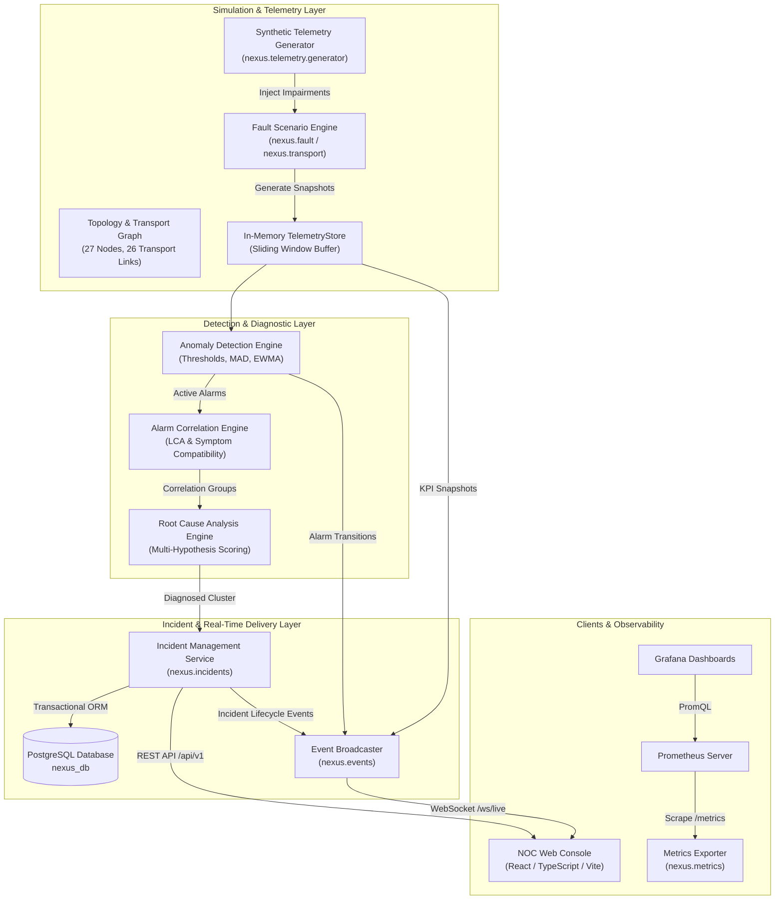

# NEXUS — Network Intelligence & Incident Management Platform

A topology-aware network intelligence and incident management platform combining deterministic network simulation, statistical anomaly detection, alarm correlation, explainable root-cause analysis, SLA tracking and real-time observability.

---

## 1. Overview

In modern telecommunications infrastructure and distributed network backbones, network operations teams face severe operational challenges during service disruptions. Upstream transport degradations or facility outages cascade through network hierarchies, triggering simultaneous symptomatic alarms across dozens of dependent sites and sector cells. In uncoordinated monitoring setups, these alarms trigger disjointed incident tickets, creating alert fatigue, obscuring the primary fault, and delaying critical incident resolution.

NEXUS solves this by anchoring telemetry processing, anomaly detection, alarm correlation, and incident triage directly to an authoritative topological graph model. By evaluating alarms against physical transport dependencies and hierarchical relationships, the platform condenses cascading alarm storms into actionable, correlated incidents with explainable root-cause diagnoses and automated SLA tracking.

---

## 2. Key Capabilities

- **Deterministic Synthetic Simulation**: Hierarchical 4-tier network graph with multi-variate telemetry generation across radio, performance, and reliability dimensions.
- **Topology-Aware Blast Radius Analysis**: Downstream fault impact modeling and recovery verification across six reference failure scenarios.
- **Decoupled Anomaly Detection**: Operational static thresholds with hysteresis alongside rolling statistical baselines (Median/MAD, EWMA) with directional KPI filtering.
- **Contamination Prevention & Recovery Hysteresis**: Evaluate-Then-Commit baseline protection policy paired with two-sample recovery hysteresis to prevent alarm flapping.
- **Topology-Aware Alarm Correlation**: Lowest Common Ancestor (LCA) graph traversal with temporal windowing, distant ancestor protection, and symptom compatibility rules.
- **Explainable Root Cause Analysis (RCA)**: Multi-hypothesis diagnostic evaluation scoring candidate causes, distinguishing nodes from transport links, and recommending triage actions.
- **Automated Incident Orchestration**: Transactional persistence in PostgreSQL with automatic alarm-to-incident lifecycle tracking and append-only audit timelines.
- **Operational SLA Management**: Tier-based acknowledgement and resolution deadlines with historical timestamp freezing upon resolution.
- **Real-Time Operational Console**: Dark-mode React NOC dashboard with live topology visualization, alarm triage, and low-latency WebSocket streaming.
- **Enterprise Observability**: Native Prometheus metrics exporter and provisioned Grafana dashboards for platform, network, alarm, incident, and infrastructure health.
- **Reproducible Evaluation**: Automated benchmarking against ground truth with deterministic metrics across all reference failure topologies.

---

## 3. Architecture

NEXUS employs a modular monolithic architecture. Subsystems communicate via validated domain models, exposing RESTful management endpoints, real-time WebSocket feeds, and Prometheus metrics.



### Subsystems and Responsibilities

| Subsystem | Package | Core Responsibility |
| :--- | :--- | :--- |
| **Topology** | `nexus.topology` | 4-tier hierarchical graph representation, node entities, invariant validation, cycle detection. |
| **Transport** | `nexus.transport` | Physical and logical transport links, endpoint validation, routing paths, capacity attributes. |
| **Telemetry** | `nexus.telemetry` | KPI snapshot validation, tier operating profiles, synthetic generation, sliding window buffer. |
| **Fault** | `nexus.fault` | Fault scenario definitions, conflict validation, downstream blast radius calculation, ground truth tracking. |
| **Detection** | `nexus.detection` | Static threshold rules, rolling Median/MAD, recursive EWMA, directional KPI filtering, alarm deduplication. |
| **Correlation**| `nexus.correlation`| Graph-based alarm grouping, Lowest Common Ancestor traversal, distant core protection, symptom compatibility. |
| **RCA** | `nexus.rca` | Multi-hypothesis candidate ranking, target type discrimination (`NODE` vs `TRANSPORT_LINK`), evidence attribution. |
| **Incidents** | `nexus.incidents` | Incident domain models, operational severity policy, SLA deadline tracking, append-only timeline. |
| **Events** | `nexus.events` | Serialized WebSocket broadcasting, cross-thread event scheduling, slow-consumer queue management. |
| **Evaluation** | `nexus.evaluation` | Ground-truth verification, alarm precision, fault recall, hybrid F1, and RCA accuracy benchmarking. |

---

## 4. Technology Stack

### Backend
- **Runtime & Language**: Python 3.12
- **Web Framework**: FastAPI (asynchronous ASGI framework)
- **Data Validation**: Pydantic v2
- **ORM & Persistence**: SQLAlchemy 2.x declarative ORM
- **Database Migrations**: Alembic
- **Relational Database**: PostgreSQL 15 (containerized production), SQLite 3 (isolated local testing)
- **ASGI Server**: Uvicorn
- **Metrics Instrumentation**: Prometheus Client library

### Frontend
- **Framework**: React 18 with Strict TypeScript
- **Bundler & Dev Server**: Vite 5.4.x
- **Routing**: React Router v6
- **Styling**: Tailwind CSS with custom Dark NOC color tokens
- **Component Icons**: Lucide React
- **Network Clients**: Native Fetch API with `AbortController` and native WebSocket client

### Infrastructure & Operations
- **Containerization**: Docker & Docker Compose v2
- **Web Gateway & Reverse Proxy**: Nginx (Alpine)
- **Metrics Scraping & Storage**: Prometheus v2.51.0
- **Observability Visualization**: Grafana 10.4.0

---

## 5. Network and Simulation Model

### 27-Node Reference Topology

NEXUS models a deterministic reference network spanning 27 nodes across 4 tiers:

```
+-------------------------------------------------------------+
|                     CORE TIER (1 Node)                      |
|                         [CORE-01]                           |
+------------------------------+------------------------------+
                               |
               +---------------+---------------+
               |                               |
+--------------v--------------+ +--------------v--------------+
|   AGGREGATION TIER (West)   | |   AGGREGATION TIER (East)   |
|         [AGG-01]            | |         [AGG-02]            |
+--------------+--------------+ +--------------+--------------+
               |                               |
       +-------+-------+               +-------+-------+
       |       |       |               |       |       |
+------v-+ +---v----+ +-v------+ +-----v--+ +---v----+ +-v------+
| SITE-01| | SITE-02| | SITE-03| | SITE-04| | SITE-05| | SITE-06|
+---+----+ +---+----+ +---+----+ +----+---+ +---+----+ +---+----+
    |          |          |           |         |          |
 (3 Cells)  (3 Cells)  (3 Cells)   (3 Cells) (3 Cells)  (3 Cells)
 CELL-01..3 CELL-04..6 CELL-07..9  CELL-10..12 CELL-13..15 CELL-16..18
```

- **Core Tier**: 1 central regional routing hub (`CORE-01`).
- **Aggregation Tier**: 2 distribution routers (`AGG-01`, `AGG-02`).
- **Site Tier**: 6 base station facilities (`SITE-01` through `SITE-06`).
- **Cell Tier**: 18 radio sector cells (`CELL-01` through `CELL-18`, 3 sectors per site).
- **Transport Links**: 26 bidirectional transport dependencies linking parent nodes to subordinate children.

### Composite Telemetry Snapshots

Each node observation is captured as an immutable `KPISnapshot` containing:
- **Performance**: `throughput_mbps`, `latency_ms`.
- **Reliability**: `connection_drop_rate_pct`, `availability_pct`, `handover_success_rate_pct`.
- **Radio** (`CELL` tier): `rsrp_dbm`, `sinr_db`, `prb_utilization_pct`.

Snapshots are stored in an in-memory, bounded sliding buffer (`TelemetryStore`) maintaining up to 60 historical observations per node for real-time statistical evaluation.

---

## 6. Detection, Correlation and RCA

### Anomaly Detection Architecture

NEXUS deploys dual anomaly detection mechanisms:
1. **Static Threshold Rules**: Configurable bounds with explicit hysteresis recovery limits to eliminate alarm flapping near decision boundaries.
2. **Rolling Statistical Baselines**:
   - *Rolling Median & MAD*: Computes windowed median and Median Absolute Deviation scaled by $1.4826$ for normal consistency. Enforces a scale floor derived from the metric profile spread to prevent hypersensitivity under low variance.
   - *Recursive EWMA*: Tracks exponentially weighted mean ($\alpha = 0.2$) and sample variance, flagging deviations exceeding 3.0 standard deviations.
   - *Directional KPI Filtering*: Categorizes metrics into higher-is-better (`throughput_mbps`, `availability_pct`, `sinr_db`, `rsrp_dbm`) and lower-is-better (`latency_ms`, `connection_drop_rate_pct`). Benign performance improvements are suppressed from alarming unless throughput exceeds `surge_ratio_threshold` (default: $2.0\times$ nominal).
   - *Two-Sample Recovery Hysteresis*: Active statistical alarms require two consecutive clean observations before transitioning to `CLEARED`, resetting on any intermediate breach.
   - *Evaluate-Then-Commit Policy*: Anomalous observations are excluded from baseline updates, preventing fault telemetry from corrupting historical references.

### Topology-Aware Alarm Correlation

The correlation engine aggregates active alarms into immutable correlation groups using graph traversal:
- **Temporal Window**: Alarms must occur within a sliding window (default: 300 seconds).
- **Lowest Common Ancestor (LCA)**: Traverses parent lineages to locate the nearest shared infrastructure ancestor within a maximum hop distance ($D_{\max} \le 2$).
- **Distant Core Protection**: Merges at `CORE-01` are rejected unless an alarm exists directly on `CORE-01`, preventing unrelated branch failures from collapsing into a single cluster.
- **Symptom Compatibility**: Localized radio phenomena (`sinr_db`, `rsrp_dbm`, `prb_utilization_pct`) are restricted to single-node affinity, while systemic metrics (`availability_pct`, `latency_ms`, `throughput_mbps`) correlate across parent-child edges.

### Root Cause Analysis (RCA)

The RCA engine evaluates correlation groups against diagnostic evaluators:
- Evaluates candidate hypotheses across reference failure types (`BACKHAUL_FAILURE`, `SITE_POWER_FAILURE`, `RADIO_INTERFERENCE`, `CELL_CONGESTION`, `CELL_OUTAGE`, `CORE_ROUTER_FAILURE`).
- Filters telemetry to observations prior to or at incident onset, discarding future or stale data.
- Ranks candidate hypotheses by confidence score ($[0.0, 1.0]$), supporting evidence items, and deterministic tie-breaking.
- Distinguishes target entities with type semantics (`NODE` vs `TRANSPORT_LINK`).
- Emits an explicit `UNKNOWN` hypothesis with recommended triage guidance if evidence is inconclusive.

---

## 7. Incident and SLA Management

### Incident Domain Lifecycle

Diagnostic clusters persist as durable operational incidents in PostgreSQL:
- **Deduplication**: Database-level unique constraint on `correlation_group_id`.
- **Severity Policy**: Operational severity (`CRITICAL`, `MAJOR`, `WARNING`, `MINOR`) and priority (`P1` to `P4`) are derived from affected node count and hierarchy tier.
- **State Machine Transitions**:
  - `OPEN` $\to$ `ACKNOWLEDGED` $\to$ `RESOLVED`
  - `OPEN` $\to$ `RESOLVED` (expedited resolution)
  - Modifications to resolved incidents are strictly rejected.
- **Append-Only Timeline**: State transitions, operator assignments, and triage notes are recorded as immutable events in `incident_timeline_events`.

### SLA Tracking

Operational SLA deadlines are calculated at incident creation:

| Severity | Priority | Acknowledgement Target | Resolution Target |
| :--- | :---: | :---: | :---: |
| **CRITICAL** | P1 | 15 minutes | 60 minutes |
| **MAJOR** | P2 | 30 minutes | 240 minutes (4 hours) |
| **WARNING** | P3 | 60 minutes | 720 minutes (12 hours) |
| **MINOR** | P4 | 120 minutes (2 hours) | 1440 minutes (24 hours) |

SLA compliance status permanently freezes upon incident resolution, preventing retroactive breaches from subsequent clock advances.

---

## 8. Observability

### Prometheus Metrics Catalog

The backend exposes operational counters and gauges at `/metrics`:
- **HTTP Transport**: `nexus_http_requests_total`, `nexus_http_request_duration_seconds`.
- **System Readiness**: `nexus_app_info`, `nexus_ready_status`, `nexus_process_uptime_seconds`, `nexus_component_ready`.
- **Network Telemetry**: `nexus_telemetry_throughput_mbps_avg`, `nexus_telemetry_latency_ms_avg`, `nexus_telemetry_availability_pct_avg`, `nexus_telemetry_drop_rate_pct_avg`.
- **Active Alarms**: `nexus_alarms_active`, `nexus_alarms_total` (partitioned by severity).
- **Incident & SLA Metrics**: `nexus_incidents_total`, `nexus_incidents_active`, `nexus_incidents_by_status`, `nexus_incidents_sla_breaches_total`, `nexus_mtta_seconds`, `nexus_mttr_seconds`, `nexus_mttd_seconds`.
- **Fault Scenarios**: `nexus_fault_injections_total`, `nexus_fault_affected_nodes_count`.

### Provisioned Grafana Dashboards

Five preconfigured dashboards are provisioned in Grafana:
1. **01 Platform Overview**: System health, uptime, active alarms by severity, request rates, error ratios.
2. **02 Network KPI Health**: Real-time throughput, latency, availability, and radio quality across all 27 nodes.
3. **03 Alarm & Incident Overview**: Active alarms, MTTA/MTTR tracking, incident status distributions, SLA compliance.
4. **04 Fault Simulation**: Active fault tracking, scenario injection rates, impacted blast radius nodes.
5. **05 API & Infrastructure Health**: ASGI request throughput, endpoint latencies, database pool health, active WebSockets.

---

## 9. Benchmark Results

The evaluation harness evaluates platform detection, correlation, and RCA diagnostic accuracy across all six reference failure scenarios under standardized conditions (`--seed 42 --steps 30`):

```bash
python scripts/run_benchmark.py --seed 42 --steps 30
```

### Verified Aggregate Performance

| Metric Category | Performance Indicator | Benchmark Result | Operational Definition |
| :--- | :--- | :---: | :--- |
| **Fault Coverage** | Reference Faults Detected | **6 / 6** (100.0%) | 1 injected fault per reference scenario |
| | Undetected Faults | **0** | Zero false negatives at the fault level |
| **Alarm Detection** | Total Alarms Raised | **704** | Across all 6 scenarios (30 simulation steps each) |
| | True Positive Alarms | **665** | Alarms on degraded nodes within active fault windows |
| | False Positive Alarms | **39** | Background metric fluctuations outside ground truth |
| | Micro Alarm Precision | **94.46%** | Alarm-level ratio: `665 / 704` |
| | Fault Recall | **100.0%** | Fault-level ratio: `6 / 6` scenarios detected |
| | Micro Hybrid $F_1$ Score | **0.9715** | Harmonic mean of alarm precision & fault recall |
| | Simulated MTTD | **0.0 s** | Mean Time to Detect from fault step onset |
| **Alarm Storm Suppression** | Correlation Groups Formed | **38** | Topology-aware incident clusters formed |
| | Alarm Reduction Ratio | **94.60%** | Ratio: `(704 raw alarms - 38 groups) / 704 alarms` |
| **Root Cause Accuracy** | Top-1 Cause Accuracy | **6 / 6** (100.0%) | Ground-truth failure cause ranked #1 |
| | Target Entity Accuracy | **6 / 6** (100.0%) | Expected node or transport link accurately isolated |
| | Both Cause & Target Accuracy| **6 / 6** (100.0%) | Both cause and target correctly diagnosed |

### Metric Interpretation & Evaluation Constraints

- **Alarm Precision vs. Fault Recall**: Precision is calculated at the **alarm level** (`TP_alarms / total_alarms`), whereas recall is calculated at the **fault level** (`detected_faults / total_faults`).
- **Hybrid $F_1$ Score**: The reported score (0.9715) is the harmonic mean of alarm-level precision and fault-level recall. Because the denominators represent distinct operational entities (alarms vs. faults), this represents a composite operational index.
- **Simulated MTTD**: The Mean Time to Detect (MTTD) is 0.0 seconds because the synthetic simulation engine applies the fault profile instantaneously at simulation step $t=0$, tripping detectors on the initial evaluated snapshot.
- **Alarm Reduction Interpretation**: The 94.60% reduction reflects an **alarm-count reduction through topological grouping** (`(alarms - groups) / alarms`), condensing 704 raw alarms into 38 actionable incident clusters.
- **Absence of False Positive Rate (FPR)**: False Positive Rate ($\frac{FP}{FP + TN}$) is undefined because True Negatives ($TN$) cannot be defined over continuous temporal telemetry streams without arbitrary negative-trial binning.

---

## 10. Quick Start

### Prerequisites
- Docker Engine 24.0+ and Docker Compose v2.20+
- Host loopback ports available: `3000`, `3001`, `8000`, `9090`

### Launching the Stack

```bash
# 1. Clone the repository
git clone https://github.com/shreysherikar/Nexus.git
cd Nexus/nexus-network-intelligence

# 2. Configure environment credentials
cp .env.example .env

# 3. Set mandatory secure passwords in .env
# Edit .env and supply strong secrets for POSTGRES_PASSWORD and GRAFANA_ADMIN_PASSWORD

# 4. Start the containerized services
docker compose up -d --build

# 5. Verify container health status
docker compose ps
```

---

## 11. Service Endpoints

All host bindings are restricted to the local loopback interface (`127.0.0.1`) by default:

| Service | Host URL | Description | Default Credentials |
| :--- | :--- | :--- | :--- |
| **NOC Web Console** | `http://localhost:3000` | React operational dashboard & topology viewer | None (Public UI) |
| **FastAPI Backend & Docs**| `http://localhost:8000/docs` | Swagger interactive API documentation | None (Open operational mode) |
| **Grafana Dashboards** | `http://localhost:3001` | Provisioned operational analytics dashboards | User: `admin`, Password: set in `.env` |
| **Prometheus Server** | `http://localhost:9090` | Raw metrics scraper and PromQL query console | None (Loopback access) |

---

## 12. Testing Commands

### Backend Automated Test Suite
```bash
# Execute the complete backend pytest suite (597 tests across 18 modules)
pytest -v --tb=short
```

### Frontend Quality Gates
```bash
cd frontend

# ESLint flat configuration check
npm run lint

# Strict TypeScript compiler verification
npm run typecheck

# Vitest component and navigation suite (69 tests across 6 modules)
npm test

# Production bundle compilation
npm run build
cd ..
```

### Live End-to-End Acceptance Verification
```bash
# Validates database isolation, live WebSockets, all 6 scenarios, and Grafana PromQL targets
python scripts/verify_e2e_acceptance.py
```

### Deterministic Benchmark Execution
```bash
# Replays 6 reference failure scenarios against precomputed ground truth
python scripts/run_benchmark.py --seed 42 --steps 30
```

---

## 13. Documentation Links

Comprehensive engineering documentation is maintained in the [`docs/`](docs/) directory:

- **[System Overview](docs/architecture/system-overview.md)**: Architectural purpose, topology hierarchy, and end-to-end data pipeline.
- **[Telemetry & KPI Model](docs/architecture/telemetry-and-kpi-model.md)**: Metric definitions, operational baselines, and synthetic generation.
- **[Anomaly Detection](docs/architecture/anomaly-detection.md)**: Threshold rules, hysteresis, statistical detectors, and alarm lifecycle.
- **[Alarm Correlation & RCA](docs/architecture/alarm-correlation-and-rca.md)**: LCA correlation algorithms, multi-hypothesis ranking, and evidence attribution.
- **[Incident Management](docs/architecture/incident-management.md)**: Relational schema, severity policies, SLA tracking, and audit timeline.
- **[Fault Simulation](docs/architecture/fault-simulation.md)**: Scenario engine, the six reference scenarios, and recovery verification.
- **[Frontend Architecture](docs/architecture/frontend-architecture.md)**: React/Vite architecture, Dark NOC design tokens, and WebSocket client.
- **[API & WebSocket Specification](docs/api-and-websocket.md)**: Complete REST API reference and WebSocket protocol contracts.
- **[Database Schema & Migrations](docs/database-schema-migrations.md)**: Relational models and Alembic migration procedures.
- **[Observability Deployment](docs/observability-deployment.md)**: Prometheus metrics, PromQL queries, and container hardening.
- **[Operations Runbook](docs/operations-runbook.md)**: Operational verification checklist, fault injection procedures, and troubleshooting.
- **[Testing & Verification Strategy](docs/testing-verification.md)**: Test catalog, execution commands, and CI workflows.
- **[ADR-001: Project Architecture](docs/decisions/ADR-001-project-architecture.md)**: Architectural Decision Record for the modular monolithic design.

---

## 14. Operating Model and Scope

NEXUS is designed as an engineering platform for network simulation, anomaly detection research, and incident triage. The following operating boundaries apply:

- **Synthetic Telemetry**: Telemetry streams are synthetically generated to enable controlled, deterministic evaluation without hardware dependencies.
- **Fixed Reference Topology**: The platform operates on a validated 27-node reference network supporting deterministic scenario reproducibility.
- **Ephemeral Telemetry Buffer**: In-memory telemetry snapshots provide live operational analysis and reset across container restarts; incident records, alarms, and audit timelines persist durably in PostgreSQL.
- **Explainable Rule-Based RCA**: Root Cause Analysis uses deterministic graph traversal and transparent heuristic scoring rather than black-box machine learning.
- **Authentication Perimeter**: Endpoints operate in an open operational mode and do not enforce internal JWT/RBAC; authentication must be provided via an API Gateway or reverse proxy for deployments requiring access controls.
- **Validation Scope**: The platform has been validated against synthetic simulation scenarios and has not been evaluated on live commercial telecommunications carrier data.

---

## 15. License

This project is licensed under the Apache License 2.0. See the [LICENSE](LICENSE) file for details.
