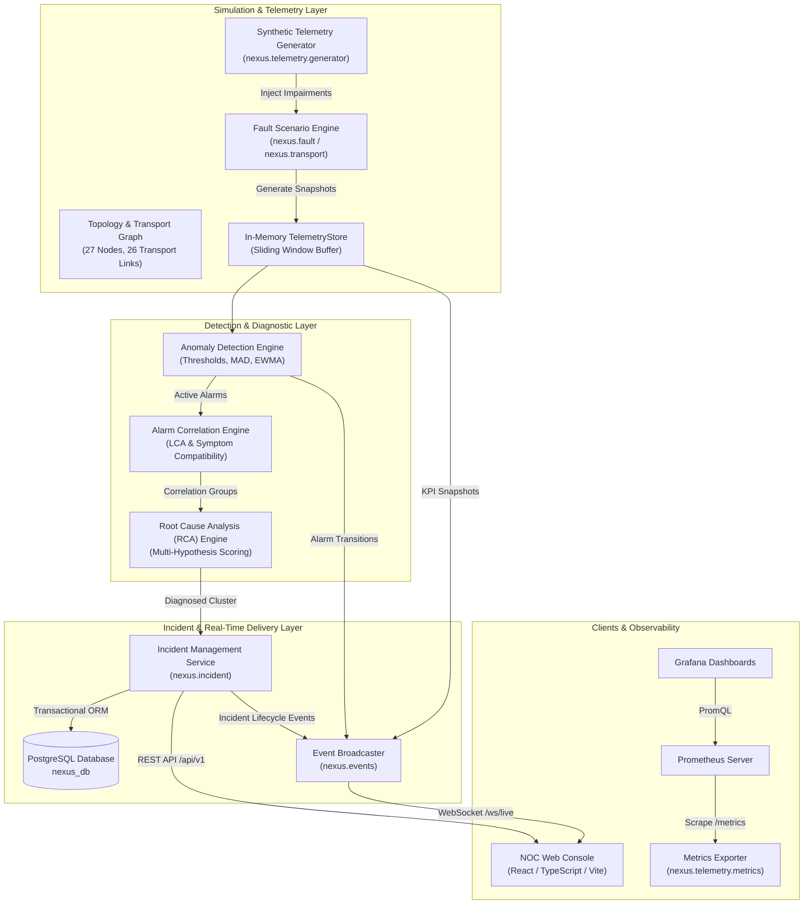

# NEXUS — Network Intelligence & Incident Management Platform

NEXUS is a modular network intelligence and automated incident management platform designed for telecommunications infrastructure observability and operations. It models hierarchical 4-tier network topologies, generates deterministic synthetic radio and performance telemetry on demand, detects anomalies using static rules and statistical baselines, correlates cascading alarms using Lowest Common Ancestor (LCA) graph algorithms, performs explainable multi-hypothesis Root Cause Analysis (RCA), and enforces operational Service Level Agreements (SLAs) through a real-time Network Operations Center (NOC) dashboard.

---

## 1. Project Overview

NEXUS provides an end-to-end operational software stack for telecommunications Network Operations Centers (NOCs). Rather than treating alarms as isolated tickets, NEXUS links real-time telemetry and alarm streams directly to an underlying network topology graph.

Key capabilities:
- **Hierarchical Network Topology**: Strict 4-tier topological modeling (`Core -> Aggregation -> Site -> Cell`) with 27 nodes and 26 bidirectional transport dependencies.
- **Deterministic Synthetic Telemetry**: Multi-variate KPI generation across radio, performance, and reliability dimensions without external dependencies.
- **Controlled Fault Simulation**: Six reference telecom failure scenarios with exact downstream blast radius calculation and recovery verification.
- **Decoupled Anomaly Detection**: Threshold detectors with hysteresis anti-flapping alongside rolling statistical baselines (Median/MAD, EWMA).
- **Topology-Aware Alarm Correlation**: Graph-based clustering of point-in-time alarms using Lowest Common Ancestor (LCA) traversal to suppress cascading symptoms.
- **Explainable Root Cause Analysis (RCA)**: Multi-hypothesis rule evaluators scoring candidate causes, identifying targets (`NODE` vs. `TRANSPORT_LINK`), and providing operational remediation guidance.
- **Persistent Incident Management**: Transactional incident tracking in PostgreSQL via SQLAlchemy and Alembic, with SLA deadline enforcement and an append-only audit timeline.
- **Real-Time Operational Delivery**: Low-latency WebSocket streaming (`/ws/live`) to a dark-mode React NOC dashboard with live topology visualization.
- **Complete Observability**: Standard Prometheus metrics exporter (`/metrics`) and provisioned Grafana dashboards.

---

## 2. Engineering Problem

Telecommunications networks and distributed service provider backbones are hierarchical, highly interdependent environments. Network Operations Centers face three critical operational bottlenecks:

1. **Cascading Alarm Storms**: When an upstream transport link or power facility fails, dozens or hundreds of downstream nodes trigger symptomatic alarms simultaneously. In a traditional ticketing system, each alarm generates an independent alert, overwhelming operators and obscuring the underlying cause.
2. **Context-Free Telemetry Triage**: High-frequency metric streams (throughput, latency, packet drop rates) arrive asynchronously without topological context. Operators must manually cross-reference network diagrams to infer whether an issue is an isolated radio cell defect or a systemic backhaul cut.
3. **Manual, Error-Prone SLA Tracking**: Correlating related alerts by hand delays Mean Time to Acknowledge (MTTA) and Mean Time to Resolve (MTTR), increasing operational overhead and causing costly SLA breaches.

NEXUS addresses these challenges by embedding topological dependency awareness directly into the telemetry ingestion, correlation, and incident triage pipeline.

---

## 3. System Architecture

The NEXUS platform follows a service-oriented modular monolithic architecture. Backend subsystems communicate via typed domain models, exposing RESTful endpoints and real-time WebSocket feeds to the web console and Prometheus scraper.



### Subsystem Boundaries

| Subsystem | Package | Architectural Responsibility |
| :--- | :--- | :--- |
| **Topology** | `nexus.topology` | 4-tier network graph representation, node models, hierarchy invariants, cycle prevention. |
| **Transport** | `nexus.transport` | Physical/logical transport link graph, upstream/downstream endpoints, routing paths. |
| **Telemetry** | `nexus.telemetry` | KPI snapshots, operational profiles, synthetic generation, in-memory sliding buffer. |
| **Fault** | `nexus.fault` | Fault models, conflict detection, reference scenarios, ground truth recording. |
| **Detection** | `nexus.detection` | Threshold rules, hysteresis, rolling median/MAD, EWMA, alarm lifecycle state machine. |
| **Correlation** | `nexus.correlation` | Temporal clustering, LCA graph traversal, symptom compatibility, distant ancestor protection. |
| **RCA** | `nexus.rca` | Multi-hypothesis diagnostic evaluation, target identification, confidence scoring, evidence attribution. |
| **Incident** | `nexus.incident` | Incident domain entity, operational severity policy, SLA tracking, append-only audit timeline. |
| **Events** | `nexus.events` | Serialized WebSocket broadcasting, cross-thread event dispatch, slow-consumer queue management. |
| **Evaluation**| `nexus.evaluation` | Post-hoc benchmark validation (precision, recall, F1, MTTD, RCA accuracy, noise reduction). |

---

## 4. Network and Telemetry Model

### 4.1 27-Node Reference Topology

NEXUS models a deterministic reference network comprising **27 nodes** across 4 hierarchical tiers:

```
+-------------------------------------------------------------+
|                     CORE TIER (1 Node)                      |
|                         [CORE-01]                           |
+------------------------------+------------------------------+
                               |
               +---------------+---------------+
               |                               |
+--------------v--------------+ +--------------v--------------+
|   AGGREGATION TIER (West)   | |   AGGREGATION TIER (East)   |
|         [AGG-01]            | |         [AGG-02]            |
+--------------+--------------+ +--------------+--------------+
               |                               |
       +-------+-------+               +-------+-------+
       |       |       |               |       |       |
+------v-+ +---v----+ +-v------+ +-----v--+ +---v----+ +-v------+
| SITE-01| | SITE-02| | SITE-03| | SITE-04| | SITE-05| | SITE-06|
+---+----+ +---+----+ +---+----+ +----+---+ +---+----+ +---+----+
    |          |          |           |         |          |
 (3 Cells)  (3 Cells)  (3 Cells)   (3 Cells) (3 Cells)  (3 Cells)
 CELL-01..3 CELL-04..6 CELL-07..9  CELL-10..12 CELL-13..15 CELL-16..18
```

- **Core Tier**: 1 regional routing hub (`CORE-01`).
- **Aggregation Tier**: 2 distribution routers (`AGG-01`, `AGG-02`).
- **Site Tier**: 6 base station facilities (`SITE-01` to `SITE-06`).
- **Cell Tier**: 18 radio sector units (`CELL-01` to `CELL-18`, 3 sectors per site).
- **Transport Links**: 26 bidirectional transport dependencies linking parent nodes to child nodes.

### 4.2 Composite KPI Snapshot

Measurements for each node are captured as an immutable composite snapshot (`KPISnapshot`) containing:
1. **Performance Metrics**: `throughput_mbps`, `latency_ms`.
2. **Reliability Metrics**: `connection_drop_rate_pct`, `availability_pct`, `handover_success_rate_pct`.
3. **Radio Metrics** (`CELL` tier only): `rsrp_dbm`, `sinr_db`, `prb_utilization_pct`.

Snapshots are stored in an in-memory, thread-safe sliding buffer (`TelemetryStore`) indexed by `node_id` and timestamp, retaining up to 60 historical observations per node for statistical evaluations.

---

## 5. Fault Simulation and Detection

### 5.1 Six Reference Fault Scenarios

NEXUS includes six deterministic fault scenarios with precomputed ground truth and blast radius calculation:

| Scenario Key | Fault Type | Target ID | Blast Radius | Primary Symptoms |
| :--- | :--- | :--- | :--- | :--- |
| `cell_outage` | `CELL_OUTAGE` | `CELL-01` | 1 node (`CELL-01`) | Throughput $\to 0$ Mbps, Availability $\to 0\%$, Drop rate $\to 100\%$. |
| `backhaul_failure` | `BACKHAUL_FAILURE` | `LINK-AGG-01-SITE-01` | 4 nodes (`SITE-01`, `CELL-01`..`03`) | Complete communication loss across downstream branch (0 Mbps, 0% availability). |
| `radio_interference`| `RADIO_INTERFERENCE` | `CELL-05` | 1 node (`CELL-05`) | Severe SINR collapse (< 5 dB), reduced throughput, elevated drops. |
| `cell_congestion` | `CELL_CONGESTION` | `CELL-10` | 1 node (`CELL-10`) | PRB utilization spikes ($\ge 90\%$), queue latency spikes (> 80 ms). |
| `site_power_failure`| `SITE_POWER_FAILURE` | `SITE-04` | 4 nodes (`SITE-04`, `CELL-10`..`12`) | Total facility power outage taking site and 3 sectors offline. |
| `core_router_failure`| `CORE_ROUTER_FAILURE` | `CORE-01` | 1 node direct / Systemic | Regional transit degradation elevating latency and triggering availability alarms. |

### 5.2 Anomaly Detection Engine

- **Static Threshold Rules**: Point-in-time checks against operational bounds with hysteresis recovery thresholds to prevent alarm flapping.
- **Statistical Baselines**:
  - *Rolling Median & MAD*: Robust deviation scoring with minimum variance scale floors.
  - *Recursive EWMA*: Exponential mean tracking with sample variance bounds.
- **Evaluate-Then-Commit Policy**: Anomalous observations are excluded from historical baseline updates, preventing baseline contamination during active faults.
- **Lifecycle Management**: Alarms follow an explicit state machine (`ACTIVE` $\to$ `CLEARED`), with immutable evidence structures and deterministic deduplication keys `(node_id, metric_name, rule_id, source)`.

---

## 6. Alarm Correlation and RCA

### 6.1 Topology-Aware Alarm Correlation

The correlation engine clusters active alarms using graph traversal:
1. **Temporal Proximity**: Groups alarms occurring within a configurable sliding window (default: 300s).
2. **Lowest Common Ancestor (LCA)**: Traverses the topology graph to find the nearest shared ancestor within a maximum hierarchy distance.
3. **Distant Core Rejection**: Rejects merging independent aggregation branches into `CORE-01` unless an alarm exists directly on `CORE-01`, preventing unrelated branch failures from collapsing into a single cluster.
4. **Symptom Compatibility**: Localized radio phenomena (`sinr_db`, `rsrp_dbm`, `prb_utilization_pct`) are restricted to single-node affinity, while systemic network metrics (`availability_pct`, `latency_ms`, `throughput_mbps`) correlate across parent-child links.

### 6.2 Multi-Hypothesis Root Cause Analysis

The RCA engine evaluates correlation clusters against deterministic diagnostic pattern evaluators:
- Evaluates candidate hypotheses for each failure category (`BACKHAUL_FAILURE`, `SITE_POWER_FAILURE`, `RADIO_INTERFERENCE`, `CELL_CONGESTION`, `CELL_OUTAGE`).
- Validates fresh telemetry observations relative to incident onset (discarding future information and stale snapshots).
- Ranks candidate hypotheses by confidence score ($[0.0, 1.0]$), evidence item count, and deterministic tie-breakers.
- Identifies suspect targets with explicit type semantics (`NODE` vs. `TRANSPORT_LINK`).
- Emits an explicit `UNKNOWN` hypothesis with recommended tier-2 manual triage actions when evidence is insufficient.

---

## 7. Incident Management

### 7.1 Incident Domain Entity & Persistence

Correlated diagnostic clusters persist as durable operational incidents in PostgreSQL via SQLAlchemy 2.x and Alembic migrations:
- **Deduplication**: Database-level unique constraint on `correlation_group_id`.
- **Operational Severity Policy**: Severity (`CRITICAL`, `MAJOR`, `WARNING`, `MINOR`) and priority (`P1` to `P4`) are derived from affected node count and topology tier rather than diagnostic confidence alone.
- **Lifecycle Transitions**: Enforces valid state machine transitions:
  - `OPEN` $\to$ `ACKNOWLEDGED` $\to$ `RESOLVED`
  - `OPEN` $\to$ `RESOLVED` (fast-path resolution)
  - Duplicate transitions or modifying resolved incidents are rejected with HTTP 400.
- **Append-Only Audit Timeline**: Every state change, actor attribution, and operational note is recorded as an immutable event in `incident_timeline_events`.

### 7.2 SLA Tracking

Configurable SLA targets enforce operational response windows:

| Severity | Priority | Acknowledgement SLA | Resolution SLA |
| :--- | :---: | :---: | :---: |
| **CRITICAL** | P1 | 15 minutes | 60 minutes |
| **MAJOR** | P2 | 30 minutes | 240 minutes (4 hours) |
| **WARNING** | P3 | 60 minutes | 720 minutes (12 hours) |
| **MINOR** | P4 | 120 minutes (2 hours) | 1440 minutes (24 hours) |

SLA compliance status permanently freezes upon resolution, preventing retroactive breaches from subsequent clock advances. Operational metrics (MTTA, MTTR, MTTD) are computed using batched pagination in $O(1)$ memory without data truncation.

---

## 8. Real-Time Architecture

NEXUS provides real-time state synchronization to connected operational clients:

- **WebSocket Endpoint**: `WS /ws/live` delivering canonical JSON event envelopes:
  ```json
  {
    "type": "TELEMETRY_SNAPSHOT",
    "timestamp": "2026-11-23T12:00:00Z",
    "payload": { ... }
  }
  ```
- **Supported Event Types**: `TELEMETRY_SNAPSHOT`, `ALARM_CREATED`, `ALARM_UPDATED`, `ALARM_CLEARED`, `INCIDENT_CREATED`, `INCIDENT_ACKNOWLEDGED`, `INCIDENT_RESOLVED`, `TOPOLOGY_STATUS_CHANGED`.
- **Concurrency & Backpressure**:
  - Dedicated single outbound writer task per socket connection serializes frames, preventing concurrent write collisions.
  - Cross-thread event dispatch uses `loop.call_soon_threadsafe()` to schedule queue insertions across thread boundaries.
  - Bounded subscriber queues (`maxsize=100`) apply a FIFO drop policy for slow consumers to safeguard server memory.
- **Client Resilience**: The frontend WebSocket client incorporates automatic exponential backoff reconnection and authoritative REST snapshot rehydration upon reconnect.

---

## 9. Observability

### 9.1 Prometheus Metrics Catalog

The FastAPI backend exposes Prometheus metrics on `/metrics`:
- **HTTP Metrics**: `nexus_http_requests_total`, `nexus_http_request_duration_seconds`.
- **Health & Readiness**: `nexus_app_info`, `nexus_ready_status`, `nexus_component_ready` (`topology`, `broadcaster`, `telemetry_store`, `alarm_service`, `fault_service`, `database`).
- **Telemetry Averages**: `nexus_telemetry_throughput_mbps_avg`, `nexus_telemetry_latency_ms_avg`, `nexus_telemetry_availability_pct_avg`, `nexus_telemetry_drop_rate_pct_avg` (partitioned by `node_tier`).
- **Alarm Metrics**: `nexus_alarms_active`, `nexus_alarms_total` (partitioned by `severity`).
- **Incident & SLA Metrics**: `nexus_incidents_total`, `nexus_incidents_active`, `nexus_incidents_by_status`, `nexus_incidents_sla_breaches_total`, `nexus_incidents_mtta_seconds`, `nexus_incidents_mttr_seconds`, `nexus_incidents_sla_compliance_pct`.
- **Fault Scenarios**: `nexus_fault_scenario_active` (labeled by `scenario_key`), `nexus_fault_affected_nodes_count`.

### 9.2 Grafana Dashboards

Five provisioned Grafana dashboards provide operational visualization:
1. **System Health & HTTP Performance**: Request rate, latency percentiles, error rates.
2. **Network Telemetry Overview**: Real-time throughput, latency, drop rates across the 27-node hierarchy.
3. **Alarm Inventory & Activity**: Active alarms, severity breakdown, and alarm generation rates.
4. **Incident & SLA Management**: MTTA, MTTR, SLA compliance rates, and breach tallies.
5. **Fault Scenario Tracking**: Injected faults, affected blast radii, and recovery convergence.

---

## 10. Technology Stack

### Backend
- **Language**: Python 3.11+
- **Framework**: FastAPI (asynchronous ASGI framework)
- **Data Modeling**: Pydantic v2
- **Persistence**: SQLAlchemy 2.x declarative ORM
- **Database Migrations**: Alembic
- **Relational Storage**: PostgreSQL 15 (production/container) with psycopg driver; SQLite (isolated testing)
- **ASGI Server**: Uvicorn
- **Metrics**: Prometheus Client library

### Frontend
- **Framework**: React 18 with Strict TypeScript
- **Build Tool**: Vite 5.4.x
- **Routing**: React Router v6
- **Styling**: Tailwind CSS with custom Dark NOC tokens
- **Icons**: Lucide React
- **HTTP/WS**: Native fetch API with AbortController and native WebSocket client

### Infrastructure & Operations
- **Containerization**: Docker & Docker Compose v2
- **Reverse Proxy**: Nginx (Alpine)
- **Monitoring**: Prometheus v2.51.0
- **Visualization**: Grafana 10.4.0

---

## 11. Deployment (Docker Compose)

### 11.1 Quick Start

```bash
# 1. Clone repository
git clone https://github.com/shreysherikar/Nexus.git
cd Nexus/nexus-network-intelligence

# 2. Configure environment
cp .env.example .env

# 3. Generate secure credentials in .env
# Edit .env and set strong POSTGRES_PASSWORD and GRAFANA_ADMIN_PASSWORD

# 4. Launch multi-service stack
docker compose up --build -d

# 5. Check container health
docker compose ps
```

### 11.2 Service Port Allocations

| Service | Container Name | Host Binding | Internal Port | Description |
| :--- | :--- | :--- | :--- | :--- |
| **Frontend** | `nexus-frontend` | `127.0.0.1:3000` | `80` | NOC Web Dashboard & Nginx reverse proxy |
| **Backend** | `nexus-backend` | `127.0.0.1:8000` | `8000` | FastAPI REST API and WebSocket server |
| **Database** | `nexus-postgres` | None (internal) | `5432` | PostgreSQL relational database |
| **Prometheus**| `nexus-prometheus`| `127.0.0.1:9090` | `9090` | Prometheus time-series metrics scraper |
| **Grafana** | `nexus-grafana` | `127.0.0.1:3001` | `3000` | Grafana operational analytics dashboards |

### 11.3 Security Hardening

- All host ports bind strictly to loopback (`127.0.0.1`) by default.
- Backend container runs as an unprivileged user (`nexus`, UID 1000).
- Privilege escalation is disabled via `no-new-privileges:true`.
- Public reverse proxy returns HTTP 404 for `/metrics`, keeping raw operational counters internal to the container network.
- Probes (`/health`, `/ready`) sanitize error details and omit raw credentials or connection strings.

---

## 12. Development and Testing

### 12.1 Local Development Workflow

```bash
# Setup Python virtual environment
python -m venv .venv
source .venv/bin/activate  # On Windows: .venv\Scripts\Activate.ps1
pip install -e ".[test]"

# Run backend development server (SQLite fallback)
export ENVIRONMENT=development  # On Windows PowerShell: $env:ENVIRONMENT="development"
python -m uvicorn nexus.main:app --host 127.0.0.1 --port 8000 --reload

# In a separate terminal, run frontend Vite dev server
cd frontend
npm ci
npm run dev
```

### 12.2 Automated Test Execution

```bash
# Backend pytest suite (557 tests across 17 test modules)
python -m pytest -v

# Frontend quality gates (from frontend/ directory)
cd frontend
npm run lint        # ESLint flat config
npm run typecheck   # Strict TypeScript compiler check
npm test            # Vitest suite (68 tests across 6 modules)
npm run build       # Production bundle build
cd ..
```

### 12.3 End-to-End Acceptance Verification

The automated acceptance test script evaluates end-to-end functionality against an isolated test database:

```bash
python scripts/verify_e2e_acceptance.py
```

The script verifies:
- Database isolation (`nexus_test_db`, leaving `nexus_db` untouched).
- Genuine WebSocket handshake, ping/pong, and `TELEMETRY_SNAPSHOT` event delivery.
- All six reference fault scenarios with degradation assertions, RCA cause/target matching, and recovery convergence.
- Prometheus scrape status and Grafana panel query execution.

---

## 13. API and Technical Documentation

Comprehensive documentation is available in the [`docs/`](docs/) directory:

- **[System Overview](docs/architecture/system-overview.md)**: Architectural purpose, topology hierarchy, and end-to-end data pipeline.
- **[Telemetry & KPI Model](docs/architecture/telemetry-and-kpi-model.md)**: Metric definitions, operational baselines, and synthetic generation.
- **[Anomaly Detection](docs/architecture/anomaly-detection.md)**: Threshold rules, hysteresis, statistical detectors, and alarm lifecycle.
- **[Alarm Correlation & RCA](docs/architecture/alarm-correlation-and-rca.md)**: LCA correlation algorithms, multi-hypothesis ranking, and evidence attribution.
- **[Incident Management](docs/architecture/incident-management.md)**: Relational schema, severity policies, SLA tracking, and audit timeline.
- **[Fault Simulation](docs/architecture/fault-simulation.md)**: Scenario engine, the six reference scenarios, and recovery verification.
- **[Frontend Architecture](docs/architecture/frontend-architecture.md)**: React/Vite architecture, Dark NOC design tokens, and WebSocket client.
- **[API & WebSocket Specification](docs/api-and-websocket.md)**: Complete REST API reference and WebSocket protocol contracts.
- **[Database Schema & Migrations](docs/database-schema-migrations.md)**: Relational models and Alembic migration procedures.
- **[Observability Deployment](docs/observability-deployment.md)**: Prometheus metrics, PromQL queries, and container hardening.
- **[Operations Runbook](docs/operations-runbook.md)**: Operational verification checklist, fault injection procedures, and troubleshooting.
- **[Testing & Verification Strategy](docs/testing-verification.md)**: Test catalog, execution commands, and CI workflows.
- **[ADR-001: Project Architecture](docs/decisions/ADR-001-project-architecture.md)**: Architectural Decision Record for the modular monolithic design.

---

## 14. Scope and Limitations

NEXUS is an engineering simulation and operations platform. The following operational boundaries and assumptions apply:

1. **Synthetic Telemetry**: All metrics and device states are synthetically modeled. Real-world 3GPP protocol state machines (e.g., GTP-U tunnel negotiation, RRC state transitions) are represented via aggregate high-level KPIs.
2. **Deterministic Heuristic RCA**: Root Cause Analysis uses explainable, deterministic rule-based algorithms with Lowest Common Ancestor graph traversal and evidence scoring. It does not use neural networks or black-box machine learning models.
3. **Fixed Reference Topology**: The core system models a 27-node reference network (1 Core, 2 Aggregation, 6 Sites, 18 Cells) designed for deterministic reproducibility.
4. **In-Memory Telemetry Storage**: Telemetry snapshots are retained in an ephemeral in-memory sliding buffer (`TelemetryStore`) and are not persisted across backend restarts. Historical persistence is dedicated to Incidents, Alarms, and Audit Timelines in PostgreSQL.
5. **Authentication & Authorization**: REST API endpoints and WebSocket channels operate in an open operational mode without OAuth2/JWT or Role-Based Access Control (RBAC). In production deployments, authentication must be enforced via an external API gateway or mutual TLS reverse proxy.

---

## 15. License

This project is licensed under the Apache License 2.0. See the [LICENSE](LICENSE) file for details.
