# NEXUS — Complete System Architecture & Diagrams

**Document Identifier**: `NEXUS-ARCH-2026-V1`  
**Target Repository**: `https://github.com/shreysherikar/Nexus`  
**Classification**: Engineering Architecture Specification & Diagram Reference  
**Platform Version**: `1.0.0`  

---

## Table of Contents

1. [High-Level Platform Architecture](#1-high-level-platform-architecture)
2. [Backend Subsystem & Service Architecture](#2-backend-subsystem--service-architecture)
3. [Database Entity-Relationship (ER) Architecture](#3-database-entity-relationship-er-architecture)
4. [27-Node Hierarchical Network Topology & Transport Map](#4-27-node-hierarchical-network-topology--transport-map)
5. [Telemetry Generation & Orchestration Pipeline](#5-telemetry-generation--orchestration-pipeline)
6. [Anomaly Detection & Baseline Protection Flow](#6-anomaly-detection--baseline-protection-flow)
7. [Alarm State Machine & Lifecycle Transitions](#7-alarm-state-machine--lifecycle-transitions)
8. [Topology-Aware Lowest Common Ancestor (LCA) Correlation Algorithm](#8-topology-aware-lowest-common-ancestor-lca-correlation-algorithm)
9. [Root Cause Analysis (RCA) Multi-Hypothesis Diagnostic Flow](#9-root-cause-analysis-rca-multi-hypothesis-diagnostic-flow)
10. [Incident Lifecycle & State Machine Transitions](#10-incident-lifecycle--state-machine-transitions)
11. [Real-Time WebSocket Stream & Concurrency Sequence](#11-real-time-websocket-stream--concurrency-sequence)
12. [Application Lifespan & Subsystem Startup Sequence](#12-application-lifespan--subsystem-startup-sequence)
13. [Full End-to-End Operational Incident Lifecycle Sequence](#13-full-end-to-end-operational-incident-lifecycle-sequence)
14. [Docker Multi-Container Deployment Architecture](#14-docker-multi-container-deployment-architecture)
15. [Automated CI/CD Workflow Pipeline](#15-automated-cicd-workflow-pipeline)

---

## 1. High-Level Platform Architecture

The following diagram represents the end-to-end distributed topology of the NEXUS platform, spanning the simulation engine, diagnostic layer, persistence tier, real-time dispatch, frontend single-page application (SPA), and Prometheus/Grafana observability stack.

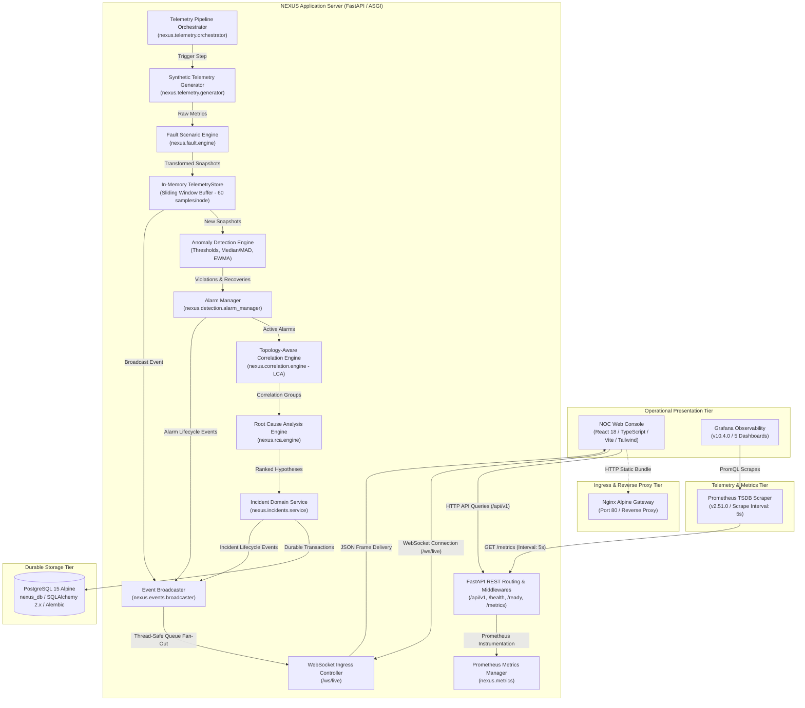

---

## 2. Backend Subsystem & Service Architecture

The NEXUS backend is structured as a decoupled, modular monolith where subsystems communicate via typed domain contracts.

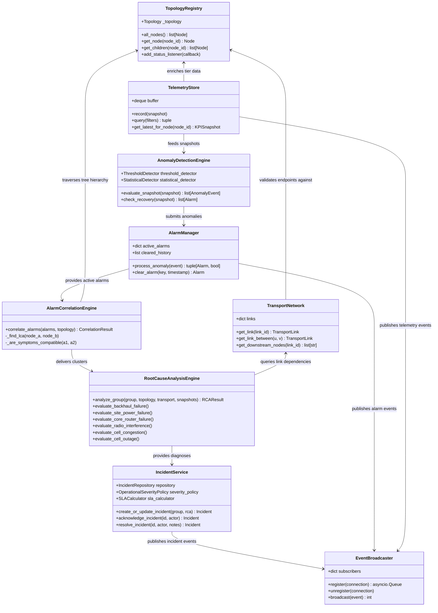

---

## 3. Database Entity-Relationship (ER) Architecture

The persistent storage tier models operational incident state, RCA findings, and an append-only immutable audit history in PostgreSQL.

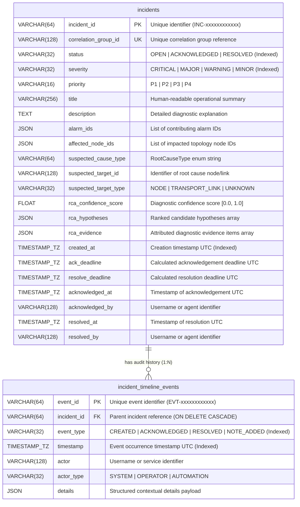

---

## 4. 27-Node Hierarchical Network Topology & Transport Map

The reference telecommunications infrastructure models 27 nodes organized in a 4-tier hierarchy interconnected by 26 bidirectional transport dependencies.

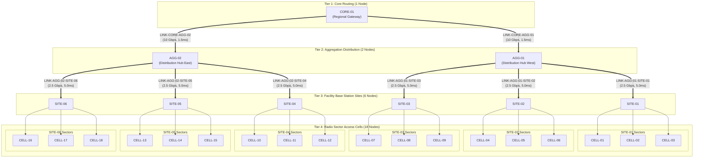

---

## 5. Telemetry Generation & Orchestration Pipeline

Execution trace during an operator or automated simulation step (`POST /api/v1/telemetry/generate-step`).

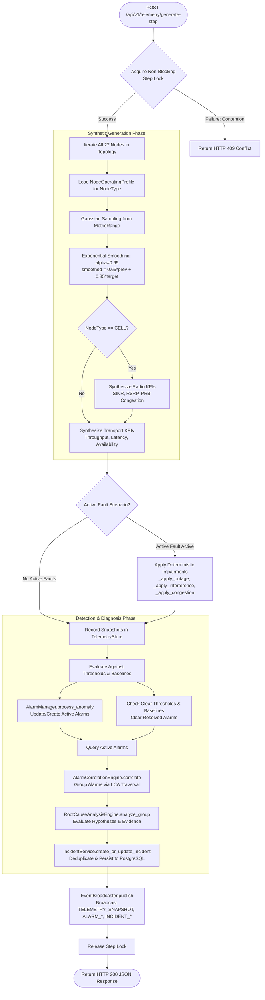

---

## 6. Anomaly Detection & Baseline Protection Flow

The Evaluate-Then-Commit policy protecting rolling statistical baselines from contamination during active faults.

```mermaid
flowchart TD
    SNAP[Incoming KPISnapshot] --> EXTRACT[Extract Metric Values]

    subgraph Static_Threshold ["Static Threshold Pipeline"]
        EXTRACT --> THRESH_RULES[Evaluate Configured ThresholdRule Set]
        THRESH_RULES --> HYST_CHECK{Breaches Threshold?}
        HYST_CHECK -->|Yes| THRESH_ANOM[Emit AnomalyEvent<br/>Source: THRESHOLD]
        HYST_CHECK -->|No| THRESH_REC{Matches Active Alarm<br/>and <= clear_threshold?}
        THRESH_REC -->|Yes| CLEAR_ALARM[Clear Alarm via AlarmManager]
        THRESH_REC -->|No| NOOP1[No Action]
    end

    subgraph Statistical_Pipeline ["Statistical Baseline Pipeline"]
        EXTRACT --> STAT_EVAL[Read-Only Baseline Evaluation]
        STAT_EVAL --> MED_CALC[Calculate Rolling Median & MAD<br/>Scale = 1.4826 * MAD<br/>EffectiveScale = max(Scale, 0.05*Median, 1.0)<br/>Score = |Value - Median| / EffectiveScale]
        STAT_EVAL --> EWMA_CALC[Calculate EWMA Residual<br/>Diff = |Value - EWMA_Mean|<br/>Spread = sqrt(EWMA_Variance)<br/>Score = Diff / max(Spread, 0.05*Mean, 1.0)]

        MED_CALC --> MED_GATE{Score >= 3.0?}
        EWMA_CALC --> EWMA_GATE{Score >= 3.0?}

        MED_GATE -->|Yes| MED_ANOM[Emit AnomalyEvent<br/>Source: STATISTICAL_MEDIAN]
        EWMA_GATE -->|Yes| EWMA_ANOM[Emit AnomalyEvent<br/>Source: STATISTICAL_EWMA]

        MED_GATE -->|No| CLEAN_MED[Clean Median Sample]
        EWMA_GATE -->|No| CLEAN_EWMA[Clean EWMA Sample]
    end

    MED_ANOM & EWMA_ANOM --> CONTAM_PREVENT{Either Detector Flagged Anomaly?}
    CONTAM_PREVENT -->|Yes: Anomaly Detected| DISCARD_UPDATE[CONTAMINATION REJECTION:<br/>Exclude Sample from BOTH Baseline Updates]
    CONTAM_PREVENT -->|No: Clean Sample| UPDATE_BASELINES[COMMIT STEP:<br/>Append to Median Deque (maxlen=20)<br/>Update Recursive EWMA Mean & Variance]
```

---

## 7. Alarm State Machine & Lifecycle Transitions

Alarms follow an explicit deterministic lifecycle state machine indexed by composite deduplication key `(node_id, metric_name, rule_id, source)`.

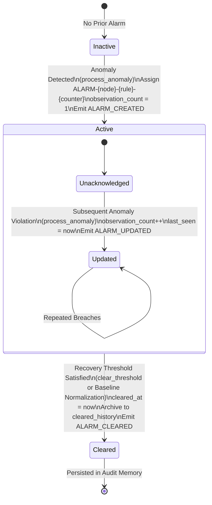

---

## 8. Topology-Aware Lowest Common Ancestor (LCA) Correlation Algorithm

Graph clustering algorithm grouping multi-node symptomatic alarms under shared physical infrastructure dependencies.

```mermaid
flowchart TD
    INPUT[Batch of Raw Alarms from AlarmManager] --> DEDUP[Deduplicate by Unique alarm_id]
    DEDUP --> SORT[Sort Deterministically:<br/>(first_seen, node_id, alarm_id)]
    SORT --> GRAPH_INIT[Initialize Adjacency Graph: N Alarm Nodes]

    subgraph Pairwise_Compatibility ["Pairwise Compatibility Evaluation"]
        GRAPH_INIT --> PAIR_LOOP[Iterate All Pairs (a1, a2)]
        PAIR_LOOP --> TIME_CHECK{abs(first_seen_1 - first_seen_2)<br/><= time_window_seconds (300s)?}
        TIME_CHECK -->|No| REJECT_EDGE[Reject Edge]
        TIME_CHECK -->|Yes| SAME_NODE{a1.node_id == a2.node_id?}
        SAME_NODE -->|Yes| ACCEPT_EDGE[Add Undirected Edge (i, j)]
        SAME_NODE -->|No| LCA_CALC[Traverse Hierarchy Bottom-Up<br/>Find Lowest Common Ancestor LCA]
        LCA_CALC --> DIST_CHECK{max(hop_dist_1, hop_dist_2)<br/><= max_ancestor_distance (2)?}
        DIST_CHECK -->|No| REJECT_EDGE
        DIST_CHECK -->|Yes| CORE_CHECK{LCA.node_type == CORE?}
        CORE_CHECK -->|Yes: Distant Ancestor| CORE_GUARD{Direct Alarm Exists on CORE?}
        CORE_GUARD -->|No| REJECT_EDGE
        CORE_GUARD -->|Yes| SYMPTOM_CHECK
        CORE_CHECK -->|No: Local Ancestor| SYMPTOM_CHECK{Are Symptoms Compatible?<br/>Exclude Localized Radio/Congestion<br/>Across Different Nodes}
        SYMPTOM_CHECK -->|Incompatible| REJECT_EDGE
        SYMPTOM_CHECK -->|Compatible| ACCEPT_EDGE
    end

    ACCEPT_EDGE --> BFS_COMPONENTS[Traverse Connected Components via BFS/Queue]

    subgraph Chaining_Protection ["Time-Window Chaining Prevention Policy"]
        BFS_COMPONENTS --> SPAN_CHECK{Candidate Group Span<br/>max(first_seen) - min(first_seen)<br/><= time_window_seconds (300s)?}
        SPAN_CHECK -->|Yes| MERGE_NODE[Include Alarm in Current Group]
        SPAN_CHECK -->|No: Exceeds Onset Span| DEFER_NODE[Defer Alarm to Subsequent Group]
    end

    MERGE_NODE --> ANCHOR_ASSIGN[Identify Group Anchor Node via _find_group_lca]
    ANCHOR_ASSIGN --> FORM_GROUP[Instantiate Immutable CorrelationGroup<br/>Assign CORR-{anchor}-{timestamp}-{index}]
    FORM_GROUP --> RESULT([Return CorrelationResult Envelope])
```

---

## 9. Root Cause Analysis (RCA) Multi-Hypothesis Diagnostic Flow

Deterministic evaluation of correlation groups against pattern matching heuristics to rank hypotheses.

```mermaid
flowchart TD
    GROUP[CorrelationGroup from CorrelationEngine] --> TEL_FILTER[Filter Telemetry Snapshots:<br/>Discard Future Information (ts > analysis_ts)<br/>Discard Stale Observations (ts < analysis_ts - max_staleness)]

    subgraph Rule_Evaluators ["Deterministic Hypothesis Evaluators"]
        TEL_FILTER --> EVAL_CORE[evaluate_core_router_failure<br/>Anchor: CORE-01, Systemic Degradation]
        TEL_FILTER --> EVAL_POWER[evaluate_site_power_failure<br/>Anchor: SITE, 0 Throughput, 0 Availability, Base Latency]
        TEL_FILTER --> EVAL_BACKHAUL[evaluate_backhaul_failure<br/>Anchor: SITE/AGG, Transport Link ID, Elevated Latency > 50ms]
        TEL_FILTER --> EVAL_INTERF[evaluate_radio_interference<br/>Target: CELL, SINR < 5dB, Drop Rate > 3%]
        TEL_FILTER --> EVAL_CONGEST[evaluate_cell_congestion<br/>Target: CELL, PRB >= 80%, Latency > 60ms]
        TEL_FILTER --> EVAL_OUTAGE[evaluate_cell_outage<br/>Target: CELL, Isolated Outage, 0 Availability]
    end

    EVAL_CORE & EVAL_POWER & EVAL_BACKHAUL & EVAL_INTERF & EVAL_CONGEST & EVAL_OUTAGE --> COLLECT[Collect Candidate RootCauseHypothesis Instances]
    COLLECT --> DEDUP_HYP[Deduplicate Candidates by (cause_type, target_id)<br/>Retain Maximum Confidence Score]
    DEDUP_HYP --> RANK[Deterministic Sorting:<br/>1. confidence_score DESC<br/>2. len(evidence_items) DESC<br/>3. target_id ASC<br/>4. cause_type.value ASC]
    RANK --> THRESH_CHECK{Highest Score >= min_confidence_threshold (0.3)?}

    THRESH_CHECK -->|Yes| PRIMARY[Select Top Candidate as Primary Hypothesis]
    THRESH_CHECK -->|No: Insufficient Evidence| UNKNOWN_FALLBACK[Instantiate Fallback Hypothesis:<br/>RootCauseType.UNKNOWN<br/>TargetType.UNKNOWN<br/>Confidence: 0.0]

    PRIMARY & UNKNOWN_FALLBACK --> REC_ACTION[Lookup Operational Recommended Action<br/>Dispatch Operations / Fiber Inspection / Grid Power]
    REC_ACTION --> RCA_OUT([Return RCAResult Record])
```

---

## 10. Incident Lifecycle & State Machine Transitions

Operational incidents enforce valid transitions, deadline freezing, and mandatory operator audit trails.

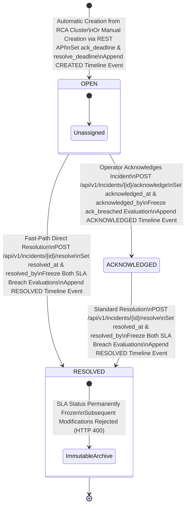

---

## 11. Real-Time WebSocket Stream & Concurrency Sequence

Asynchronous fan-out architecture across publisher worker threads, event queues, and WebSocket connections.

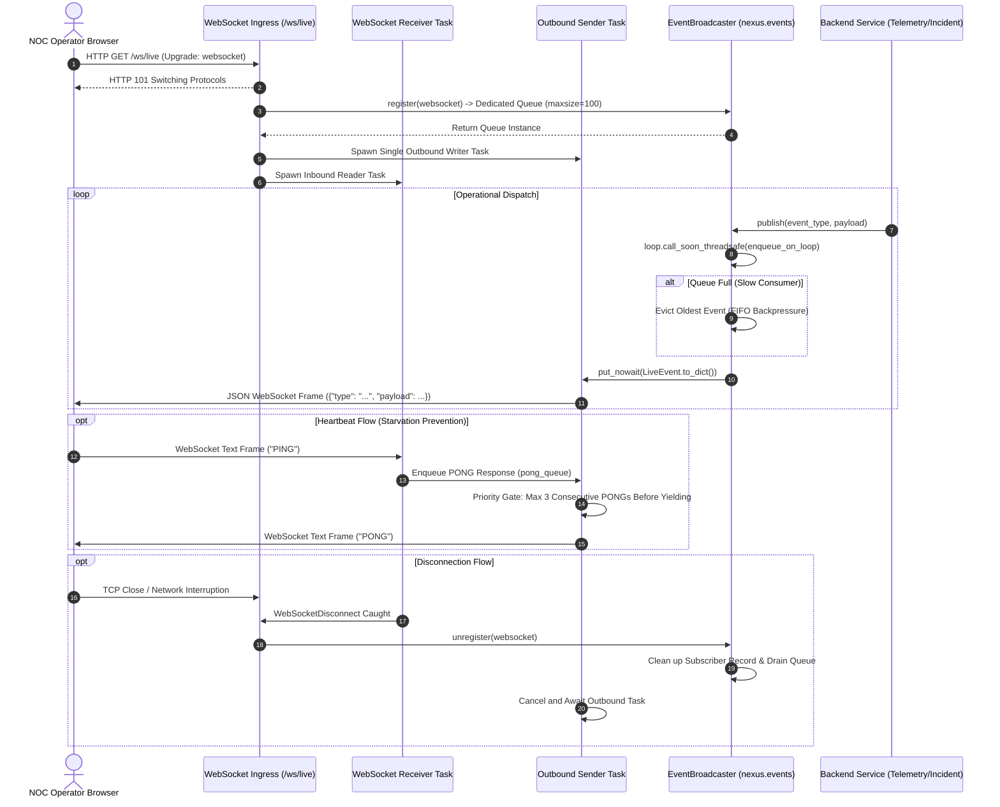

---

## 12. Application Lifespan & Subsystem Startup Sequence

Deterministic startup, dependency wiring, probe readiness, and shutdown cleanup sequence.

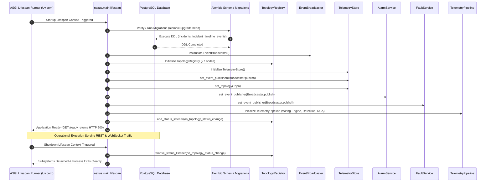

---

## 13. Full End-to-End Operational Incident Lifecycle Sequence

Step-by-step trace of a live telecom fault from injection to recovery and operator resolution.

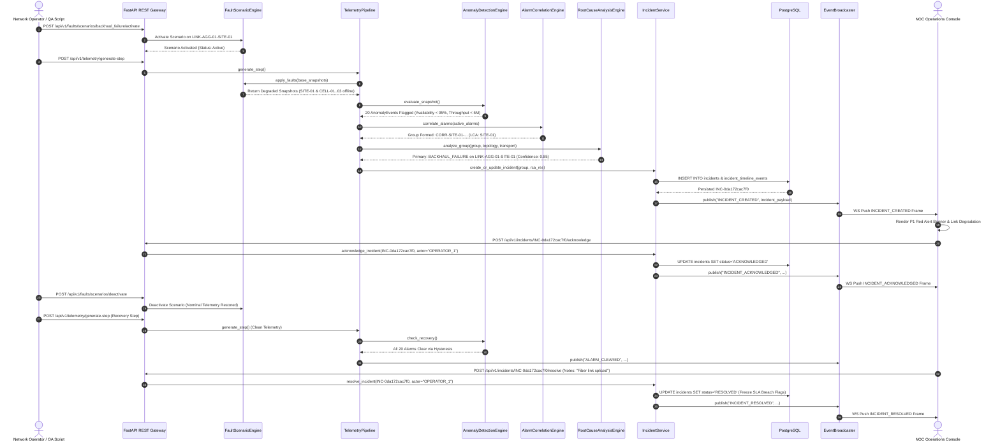

---

## 14. Docker Multi-Container Deployment Architecture

Container topology, isolation networks, volume mappings, and ingress bindings.

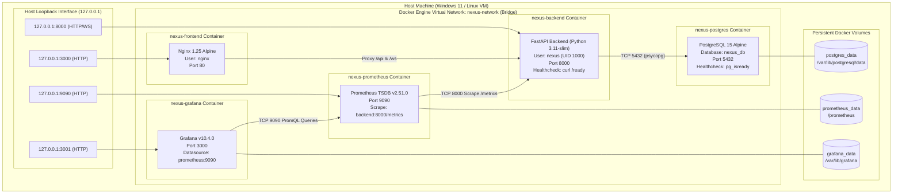

---

## 15. Automated CI/CD Workflow Pipeline

Continuous Integration and Verification pipeline implemented in `.github/workflows/ci.yml`.

```mermaid
flowchart LR
    PUSH([Git Push / PR to main]) --> CI_JOB[GitHub Actions Runner: ubuntu-latest]

    subgraph Backend_Matrix ["Backend Verification Matrix"]
        PY_ENV[Setup Python 3.11] --> PIP_CACHE[Cache Pip Dependencies]
        PIP_CACHE --> PIP_INSTALL[Install Package with Test Dependencies<br/>pip install -e .[test]]
        PIP_INSTALL --> FLAKE[Linting & Code Style<br/>flake8 / black check]
        FLAKE --> PYTEST[Execute Pytest Test Suite<br/>pytest -v --cov=src/nexus]
        PYTEST --> PYTEST_REPORT[Validate 571 Passing Tests & Coverage]
    end

    subgraph Frontend_Matrix ["Frontend Verification Matrix"]
        NODE_ENV[Setup Node.js 20] --> PNPM_SETUP[Enable Corepack & Pnpm 9.15.4]
        PNPM_SETUP --> PNPM_INSTALL[Install Frozen Dependencies<br/>pnpm install --frozen-lockfile]
        PNPM_INSTALL --> TYPE_CHECK[TypeScript Type Check<br/>pnpm run typecheck]
        TYPE_CHECK --> VITEST[Execute Vitest Component Tests<br/>pnpm run test]
        VITEST --> VITE_BUILD[Execute Production Vite Build<br/>pnpm run build]
    end

    subgraph E2E_Docker_Verification ["Live Container & Acceptance Gate"]
        DOCKER_BUILD[Docker Compose Build<br/>docker compose build]
        DOCKER_UP[Spin Up Multi-Container Stack<br/>docker compose up -d]
        HEALTH_WAIT[Wait for Healthchecks: 5/5 Healthy]
        E2E_SCRIPT[Execute Acceptance Script<br/>python scripts/verify_e2e_acceptance.py]
    end

    CI_JOB --> Backend_Matrix & Frontend_Matrix
    PYTEST_REPORT & VITE_BUILD --> E2E_Docker_Verification
    E2E_SCRIPT --> VERDICT([Success: Build & Tests Passed])
```
