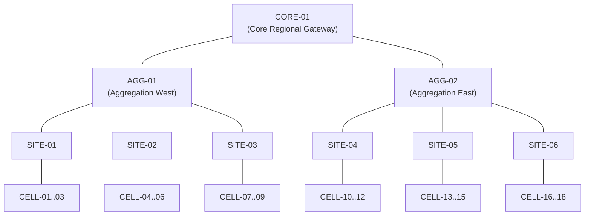
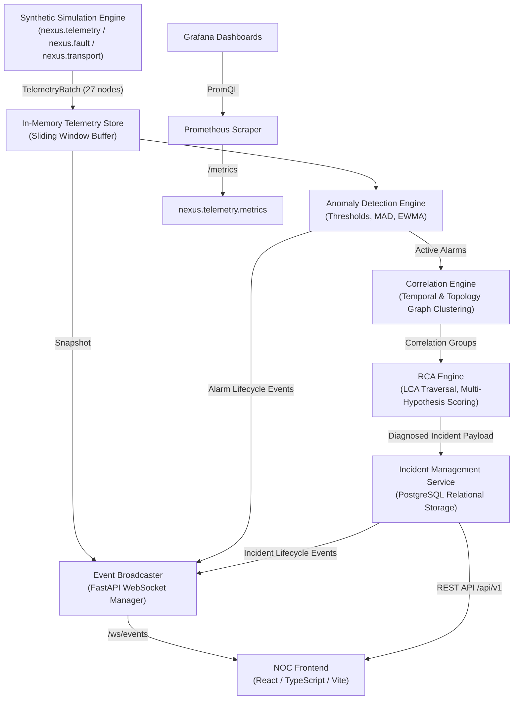

# NEXUS System Overview

## 1. System Purpose & Engineering Problem

Telecommunications networks and distributed service provider backbones are hierarchical, highly interdependent environments. Network Operations Centers (NOCs) face significant operational bottlenecks:

- **Cascading Alarms**: A failure in an upstream transport or core device triggers dozens or hundreds of symptomatic downstream alarms from subordinate nodes (for example, a severed backhaul link to a site causes every sector cell at that site to trigger link-loss, throughput drop, and unreachable alarms).
- **Heterogeneous Telemetry**: Operational metrics (throughput, latency, packet drop rates), discrete events (syslog strings), and threshold alarms arrive asynchronously with varying formats and timestamps.
- **Context-Free Incident Handling**: Traditional ticketing tools capture raw alert streams without topological awareness, leaving operators to manually infer failure loci and calculate customer blast radius.

NEXUS solves these challenges by combining hierarchical network topology modeling, deterministic KPI generation, real-time threshold and statistical anomaly detection, graph-based alarm correlation, multi-hypothesis Root Cause Analysis (RCA), persistent incident lifecycle management with SLA tracking, and live WebSocket streaming into a unified operational platform.

---

## 2. Simulated Network Topology

To maintain total reproducibility and eliminate reliance on live carrier connections or physical hardware, NEXUS models a deterministic synthetic topology comprising **27 total nodes** and **26 bidirectional transport links** across 4 hierarchical tiers.

### Hierarchy Breakdown

| Tier | Node Count | Identifiers | Description |
| :--- | :--- | :--- | :--- |
| **Core** | 1 | `CORE-01` | Centralized regional routing hub; primary simulated IP transit gateway. |
| **Aggregation** | 2 | `AGG-01`, `AGG-02` | Redundant regional distribution routers managing backhaul links for assigned sites. |
| **Site** | 6 | `SITE-01` to `SITE-06` | Physical base station facilities / tower locations (3 assigned to `AGG-01`, 3 assigned to `AGG-02`). |
| **Cell** | 18 | `CELL-01` to `CELL-18` | Simulated radio sector units (3 cells per site: Alpha, Beta, Gamma sectors handling radio carrier traffic). |

### Structural Hierarchy & Transport Links

- **Core Tier**: `CORE-01` connects via backhaul transport links to `AGG-01` (`LINK-CORE-01-AGG-01`) and `AGG-02` (`LINK-CORE-01-AGG-02`).
- **Aggregation Tier**:
  - `AGG-01` connects to `SITE-01` (`LINK-AGG-01-SITE-01`), `SITE-02` (`LINK-AGG-01-SITE-02`), and `SITE-03` (`LINK-AGG-01-SITE-03`).
  - `AGG-02` connects to `SITE-04` (`LINK-AGG-02-SITE-04`), `SITE-05` (`LINK-AGG-02-SITE-05`), and `SITE-06` (`LINK-AGG-02-SITE-06`).
- **Site & Cell Tier**:
  - `SITE-01` hosts `CELL-01`, `CELL-02`, `CELL-03`
  - `SITE-02` hosts `CELL-04`, `CELL-05`, `CELL-06`
  - `SITE-03` hosts `CELL-07`, `CELL-08`, `CELL-09`
  - `SITE-04` hosts `CELL-10`, `CELL-11`, `CELL-12`
  - `SITE-05` hosts `CELL-13`, `CELL-14`, `CELL-15`
  - `SITE-06` hosts `CELL-16`, `CELL-17`, `CELL-18`

Each cell sector connects to its parent site through a dedicated radio-distribution link (`LINK-SITE-XX-CELL-YY`), yielding a total of 26 bidirectional transport dependencies.

---

## 3. End-to-End Processing Pipeline

The NEXUS architecture operates as a unidirectional, event-driven pipeline where raw time-series data transitions through anomaly evaluation, topological clustering, causal diagnosis, and persistent operational triage.

### Pipeline Stages

1. **Synthetic Telemetry Generation (`nexus.telemetry`)**: Emits deterministic, typed KPI samples (latency, packet loss, bandwidth, radio link quality) for all 27 nodes at discrete simulation ticks. Controlled fault-injection scenarios (`nexus.fault`, `nexus.transport`) alter normal distribution parameters to simulate hardware failures, power outages, and network congestion.
2. **Telemetry Ingestion & Buffering (`nexus.telemetry.store`)**: Normalizes incoming samples and stores them in an in-memory, thread-safe sliding window buffer (`TelemetryStore`) indexed by `node_id` and timestamp.
3. **Anomaly Detection (`nexus.detection`)**: Evaluates incoming metric samples against static rule thresholds and dynamic statistical baselines (Median Absolute Deviation and Exponentially Weighted Moving Average), generating, updating, or clearing typed alarms.
4. **Alarm Correlation (`nexus.correlation`)**: Ingests active alarms across the 27-node network and groups them into correlation clusters based on temporal proximity, topological graph connectivity, and symptom compatibility.
5. **Root Cause Analysis (`nexus.rca`)**: Evaluates correlation clusters against the network hierarchy using Lowest Common Ancestor (LCA) algorithms, scores multiple diagnostic hypotheses, attributes supporting and refuting evidence, and identifies the failure locus and affected blast radius.
6. **Incident Management (`nexus.incident`)**: Converts correlated clusters and diagnostic findings into durable, auditable operational incidents stored in PostgreSQL. Manages state transitions (`OPEN`, `ACKNOWLEDGED`, `RESOLVED`), calculates SLA acknowledgment and resolution deadlines, tracks MTTA/MTTR, and maintains an immutable audit timeline.
7. **Real-Time Delivery (`nexus.api.websocket`)**: Broadcasts telemetry snapshots, alarm state transitions, and incident lifecycle updates to connected frontend clients via `/ws/events`.
8. **Operations Web Console (`frontend/`)**: Single-page application providing an interactive node-link network map, live telemetry charts, alarm workbench, incident detail drawer with timeline, and scenario execution controls.
9. **Observability (`nexus.telemetry.metrics`)**: Exposes standard Prometheus metrics on `/metrics`, scraped by Prometheus and visualized in dedicated Grafana dashboards.

---

## 4. Key Architectural Boundaries

The platform enforces strict modular boundaries:

- **Decoupled Simulation**: The simulation engine produces standard Pydantic telemetry models and is decoupled from detection and incident management. The simulation can be driven by manual REST triggers (`POST /api/v1/telemetry/generate-step`) or automated test scripts.
- **Stateless Correlation & RCA**: Correlation and RCA logic operate purely on provided alarm sets and topology graph definitions, returning immutable value objects (`CorrelationGroup`, `RCAResult`). They maintain no persistent state, enabling deterministic evaluation and testability.
- **Relational Persistence for Incidents**: Incident records, alarm linkages, and lifecycle audit events persist to PostgreSQL via SQLAlchemy ORM models and Alembic migrations. Relational operations use transactional sessions with optimistic concurrency protection.
- **Isolated Acceptance Testing**: Operational and acceptance verification runs against an isolated test database (`nexus_test_db`) or in-memory SQLite instances to guarantee that primary operational data (`nexus_db`) is never modified during verification.
